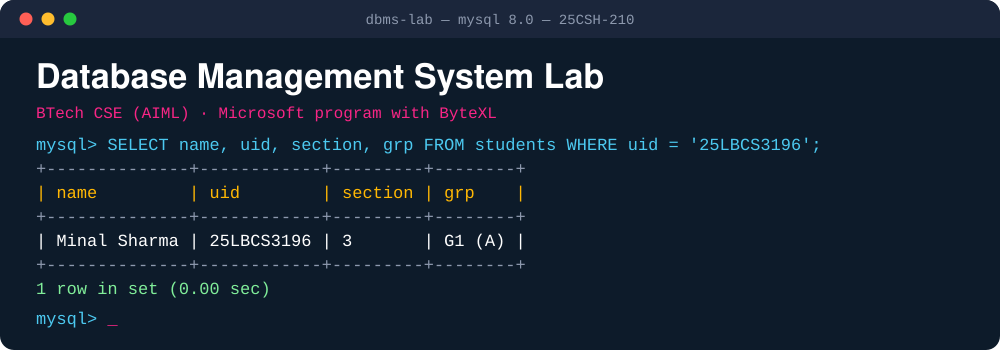
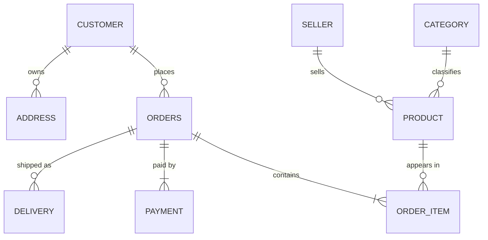
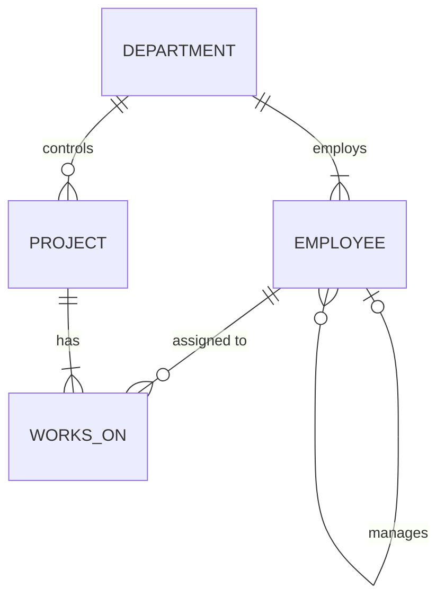

<table align="center">
<tr>
<td align="center" width="50%"></td>
<td align="center" width="50%"></td>
</tr>
</table>

<p align="center"></p>

<p align="center">


</p>


## $\color{#C9184A}{\texttt{Student Record}}$

<table align="center">
<thead>
<tr><th align="left">Field</th><th align="left">Value</th></tr>
</thead>
<tbody>
<tr><td><code>name</code></td><td><b>Minal Sharma</b></td></tr>
<tr><td><code>uid</code></td><td><code>25LBCS3196</code></td></tr>
<tr><td><code>program</code></td><td>BTech CSE (AIML) – Microsoft</td></tr>
<tr><td><code>section</code></td><td>3</td></tr>
<tr><td><code>group</code></td><td>G1 (A)</td></tr>
<tr><td><code>subject_name</code></td><td>Database Management System</td></tr>
<tr><td><code>subject_code</code></td><td><code>25CSH-210</code></td></tr>
<tr><td><code>provided_by</code></td><td>Microsoft and ByteXL</td></tr>
</tbody>
</table>


## $\color{#7B2CBF}{\texttt{About}}$

This repository contains my **DBMS lab experiments**. Each experiment has:

- a **lab record** (`Exp_N.md`) with the aim, theory, implementation, output and result
- a **runnable SQL script** that reproduces every output shown in the record

All queries were executed on **MySQL 8.0**, and the outputs in each record are copied from real runs. The diagrams are written in **Mermaid**, so GitHub renders them directly in the browser.


## $\color{#0077B6}{\texttt{Experiments}}$

<table>
<tr>
<td valign="top" width="33%">


**ER Diagram:** Indian E-Commerce Platform

<sub>Keys · composite and multi-valued attributes · weak entities · specialization · participation constraints</sub>

[`Exp_1.md`](Exp_1.md)

</td>
<td valign="top" width="33%">


**ER to Relational Schema**

<sub>PK / FK · NOT NULL · UNIQUE · CHECK · CASCADE / SET NULL · integrity violations</sub>

[`Exp_2.md`](Exp_2.md) · [`ecommerce_schema.sql`](ecommerce_schema.sql)

</td>
<td valign="top" width="33%">


**Employee–Department–Project Queries**

<sub>Selection · projection · aggregates · GROUP BY · HAVING · CASE · ORDER BY</sub>

[`Exp_3.md`](Exp_3.md) · [`company_queries.sql`](company_queries.sql)

</td>
</tr>
<tr>
<td valign="top" width="33%">


**Joins, Subqueries and EXPLAIN**

<sub>Inner / left / self / 3-way joins · correlated subqueries · EXISTS · INTERSECT / EXCEPT · execution plans</sub>

[`Exp_4.md`](Exp_4.md) · [`joins_subqueries.sql`](joins_subqueries.sql)

</td>
<td valign="top" width="33%">


**Views and Recursive CTEs**

<sub>Summary and hierarchy views · view updatability · WITH CHECK OPTION · reporting chains</sub>

[`Exp_5.md`](Exp_5.md) · [`views_recursive_cte.sql`](views_recursive_cte.sql)

</td>
<td valign="top" width="33%">


**Stored Procedures and Triggers**

<sub>transfer_employee · SIGNAL / RESIGNAL · error handlers · salary and audit triggers · edge cases</sub>

[`Exp_6.md`](Exp_6.md) · [`procedures_triggers.sql`](procedures_triggers.sql)

</td>
</tr>
</table>


## $\color{#2D6A4F}{\texttt{Repository Structure}}$

```
DBMS-Lab/
├── README.md                    -- index and student record (this page)
├── assets/                      -- logos, terminal banners, dotted rules
│
├── Exp_1.md                     -- ER diagram
├── Exp_2.md                     -- relational schema and constraints
├── Exp_3.md                     -- basic SQL queries
├── Exp_4.md                     -- joins, subqueries, EXPLAIN
├── Exp_5.md                     -- views and recursive CTEs
├── Exp_6.md                     -- procedures and triggers
│
├── ecommerce_schema.sql         -- Exp 2 : creates ecommerce_db
├── company_queries.sql          -- Exp 3 : creates company_db (used by Exp 4-6)
├── joins_subqueries.sql         -- Exp 4
├── views_recursive_cte.sql      -- Exp 5
└── procedures_triggers.sql      -- Exp 6
```


## $\color{#B26B00}{\texttt{Getting Started}}$

**Prerequisites:** MySQL Server **8.0.31 or later** (native `INTERSECT` / `EXCEPT` in Exp 4), plus the MySQL command-line client or MySQL Workbench.

```bash
git clone https://github.com/<your-username>/<repository-name>.git
cd <repository-name>
```

```bash
# Experiment 2: e-commerce database (independent)
mysql -u root -p -t --force < ecommerce_schema.sql

# Experiment 3: creates company_db. Run this BEFORE Experiments 4, 5 and 6
mysql -u root -p -t < company_queries.sql

# Experiments 4–6 run on company_db
mysql -u root -p -t          < joins_subqueries.sql
mysql -u root -p -t --force  < views_recursive_cte.sql
mysql -u root -p -t --force  < procedures_triggers.sql
```

> [!WARNING]
> Experiments 2, 5 and 6 **deliberately trigger errors** to demonstrate constraints, view rules and triggers. `--force` keeps the script running past them.

> [!TIP]
> Experiment 6 changes employee data. Re-run `company_queries.sql` to start again from clean data.


## $\color{#0081A7}{\texttt{Databases Used}}$

| Database | Experiments | Tables | Highlights |
|---|:---:|:---:|---|
| `ecommerce_db` | 1–2 | 16 | Customers with saved addresses, sellers with GSTIN / PAN, products specialised into four types, orders, UPI / Card / COD payments, courier deliveries |
| `company_db` | 3–6 | 4 + logs | 5 departments, 32 employees, 8 projects, 40 assignments, and a manager hierarchy for recursive queries |

<details>
<summary><b>Show both schema diagrams</b></summary>

<br/>

**`ecommerce_db`**



**`company_db`**



</details>


## $\color{#C9184A}{\texttt{Concepts Covered}}$

| Module | Concepts | Exp |
|---|---|:---:|
| $\color{#C9184A}{\texttt{modelling}}$ | ER diagrams, attribute types, weak entities, specialization, participation and cardinality, ER-to-relational mapping | 1, 2 |
| $\color{#7B2CBF}{\texttt{integrity}}$ | Primary / foreign / unique keys, `NOT NULL`, `CHECK`, `CASCADE` / `SET NULL` / `RESTRICT`, violations | 2 |
| $\color{#0077B6}{\texttt{querying}}$ | Selection, projection, `DISTINCT`, aggregates, `GROUP BY`, `HAVING`, `CASE`, `ORDER BY` | 3 |
| $\color{#2D6A4F}{\texttt{advanced}}$ | Inner, outer, self and multi-table joins, correlated subqueries, `EXISTS`, relational division, `INTERSECT` / `EXCEPT` | 4 |
| $\color{#B26B00}{\texttt{optimisation}}$ | `EXPLAIN`, `FORMAT=TREE`, `EXPLAIN ANALYZE`, indexes, access types, semi- and anti-join plans | 4 |
| $\color{#0081A7}{\texttt{programming}}$ | Views, updatability, `WITH CHECK OPTION`, recursive CTEs, stored procedures, `SIGNAL` / `RESIGNAL`, triggers, audit logs | 5, 6 |


## $\color{#7B2CBF}{\texttt{Tools}}$

<p>


</p>


<table align="center">
<tr>
<td align="center"></td>
<td align="center">
<code>Minal Sharma · 25LBCS3196 · Section 3 · Group G1 (A)</code><br/>
<sub>Database Management System (25CSH-210) · BTech CSE (AIML) – Microsoft · provided by Microsoft and ByteXL</sub>
</td>
<td align="center"></td>
</tr>c
</table>
